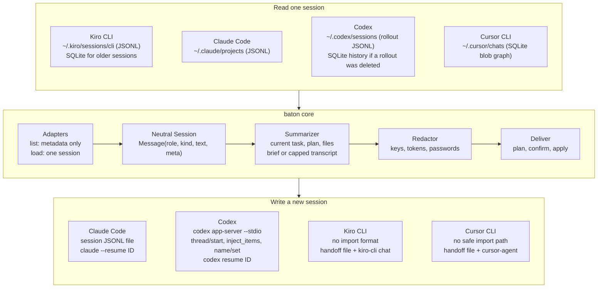
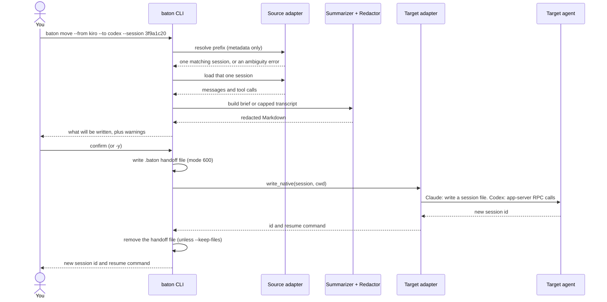

# baton

[](https://github.com/VpkPrasanna/agent-baton/blob/main/LICENSE)


**Hand one coding-agent session to another assistant when your usage runs out.**

Works between **Kiro CLI, Claude Code, Codex and Cursor CLI**: read from any of them, write into Claude Code or
Codex as a real session, or into Kiro and Cursor as a handoff file with a launch command.

You are deep in a Kiro CLI session and your credits run out. `baton` reads that one session, turns it into a
compact brief (or a size-capped transcript), strips secrets, and creates a new session in Claude Code or Codex
that already knows the task, the plan, the files touched and where you stopped. You get a session id and a
resume command.

```bash
baton move --from kiro --session 3f9a1c20 --to claude
# new claude session id: 7c1e4d52-91ab-4f3e-8d20-5b6a0c9e1f34
# resume it (run in /path/to/project):
#   claude --resume 7c1e4d52-91ab-4f3e-8d20-5b6a0c9e1f34
```

- **One session at a time.** Only the session you pick is parsed. Nothing else is loaded.
- **Summarize or move everything.** `--summarize` (default) sends a brief. `--full` sends the brief plus as much of the recent transcript as fits (Claude Code to Codex uses Codex's official importer for the whole session).
- **Real sessions in the target.** Claude Code and Codex get a resumable session with an id, not just a file.
- **Safe by default.** Source sessions are never modified, secrets are redacted, and nothing is written until you confirm.
- **No dependencies.** Pure Python standard library.

## Contents

[Install](#install) · [Usage](#usage) · [What you get in each target](#what-you-get-in-each-target) · [Supported moves](#supported-moves-and-how-well-each-is-tested) · [What the handoff contains](#what-the-handoff-contains) · [Architecture](#architecture) · [Safety and privacy](#safety-and-privacy) · [Status and limitations](#status-and-limitations) · [Troubleshooting](#troubleshooting) · [Releasing](#releasing-maintainers) · [Development](#development) · [License](#license)

## Install

Requires Python 3.10 or newer (tested on 3.10 through 3.14, on macOS). Moving *into* Codex also needs the
`codex` command on your PATH.

### With uv (recommended)

```bash
uv tool install baton-agents     # installs the `baton` command
baton --help

uv tool upgrade baton-agents     # later, to update
```

Or run it without installing anything:

```bash
uvx baton-agents --help
uvx baton-agents move --from kiro --to claude
```

### With pip

```bash
pip install baton-agents
baton --help
```

### From source

```bash
git clone <this repo> baton && cd baton
uv tool install .               # or: python3 -m venv .venv && source .venv/bin/activate && pip install .
```

To run straight from a checkout without installing: `PYTHONPATH=src python3 -m agent_baton.cli --help`.

The package is named `baton-agents` on PyPI because `baton`, `baton-cli` and `agent-baton` were unavailable (PyPI
refuses names that match an existing project once hyphens and underscores are ignored). Its Python import package is
`agent_baton`, so it cannot clash with any other project's `baton` module. The command is `baton`, also available as
`baton-agents`. The source repository is still called `agent-baton`.

## Usage

### 1. Find the session

```bash
baton list --from kiro                 # sessions started in the current directory
baton list --from codex --all          # every directory
baton list --from kiro --all --no-subagents   # hide sessions Kiro itself started
```

`list` reads metadata only (id, folder, time, first prompt). Ids are shown as the shortest prefix that is unique,
so you can copy them straight into `--session`.

### 2. Move it

```bash
# Summary (default): compact brief
baton move --from kiro --to claude --session 3f9a1c20

# Whole conversation. Claude Code -> Codex uses Codex's official importer; other pairs get the brief
# plus the most recent messages that fit under --max-chars
baton move --from claude --to codex --session 5d8e7b10 --full

# Pick interactively from this directory's sessions
baton move --from codex --to claude

# See exactly what would be written, without writing anything
baton move --from kiro --to codex --session 3f9a1c20 --dry-run
```

`baton` shows what it will write and asks `write files? [y/N]` before touching anything. Add `-y` to skip the prompt.

### 3. Resume it in the target

`baton` prints the new session id and the command to run. Run it from the printed folder:

```text
new codex session id: 01a1b2c3-d4e5-7f60-8a9b-0c1d2e3f4a5b
resume it (run in /Users/me/project):
  codex resume 01a1b2c3-d4e5-7f60-8a9b-0c1d2e3f4a5b
```

### Command reference

| Command | Option | Meaning |
|---|---|---|
| `list` | `--from {kiro,claude,codex,cursor}` | Source agent (required) |
| | `--all` | All directories, not just the current one |
| | `--limit N` | Rows to show (default 20) |
| | `--no-subagents` | Hide sessions the agent started itself. Kiro tags them, and they are shown and labelled `[subagent]` by default |
| `move` | `--from`, `--to` | Source and target agent (required, must differ) |
| | `--session ID` | Session id or unique prefix. Omit to pick interactively |
| | `--summarize` / `--full` | Compact brief (default) / capped transcript |
| | `--last-n N` | Messages kept verbatim in the brief (default 8) |
| | `--max-chars N` | Size cap for `--full` (default 200,000, about 50k tokens) |
| | `--all`, `--no-subagents` | Same as `list`, for the picker and source |
| | `--dry-run` | Print the handoff, write nothing |
| | `--keep-files` | Keep the handoff file even after a session was created |
| | `--no-native` | Do not create a session in the target: only write the handoff file and print the launch command. Use it for a target whose session format you would rather not have baton write |
| | `-y`, `--yes` | Skip the confirmation prompt |

## What you get in each target

| Target | What baton creates | Resume with |
|---|---|---|
| **Claude Code** | A session file in `~/.claude/projects/<folder>/`, titled "Moved from kiro: …", private (mode 600) | `claude --resume <id>` |
| **Codex** | A thread created through Codex's own API (`codex app-server --stdio`: `thread/start`, `thread/inject_items`, `thread/name/set`). For `--full` from Claude Code, Codex's own importer brings in the whole session instead (see below). Baton never writes into Codex's files or databases | `codex resume <id>` |
| **Kiro CLI** | Kiro has no import format, so there is no session id. You get the handoff file in `.baton/` | `kiro-cli chat '<prompt>'` (printed) |
| **Cursor CLI** | Cursor's chat store is an undocumented graph of content-addressed blobs, which baton does not write into, so there is no session id. You get the handoff file in `.baton/` | `cursor-agent '<prompt>'` (printed) |

Both `--summarize` and `--full` create a native session in Claude and Codex. With `--summarize` the new session
contains the brief plus a short acknowledgement. With `--full` it contains the brief plus the most recent messages
that fit under `--max-chars`, with tool calls and results flattened to text.

**Claude Code to Codex with `--full`** goes through Codex's official importer first, the same one behind `/import` in
Codex CLI. Baton calls `externalAgentConfig/detect`, picks only the session you chose from what Codex lists, and
sends just that one to `externalAgentConfig/import`, then waits for Codex to report it done. You get the whole
conversation (not capped by `--max-chars`) with a title and a thread that shows in Codex's picker straight away.
Reasoning is dropped and tool calls become text wrapped in `[external_agent_tool_call: NAME]` markers.
If Codex does not list the session, or the import fails or times out, baton says why and builds the session itself
from the brief and the most recent messages, as for every other pair. `--summarize` never uses the importer.

Once a session exists in the target, the handoff file has served its purpose and baton **removes the file it just
wrote** (and the `.baton/` folder if that leaves it empty; it never touches other files). It stays when you pass
`--keep-files`, when the target is Kiro or Cursor, or when creating the session failed, in which case baton prints the
launch command as a fallback. With `--no-native`, baton never creates a session in the target: it writes the handoff file,
keeps it, and prints the launch command, whichever agent the target is.

## What the handoff contains

The brief is built deterministically, with no model calls:

| Section | Why it is there |
|---|---|
| **Current task** | The latest user request. If it is a short reply such as "yes do it", the last substantive request and the assistant message it answered are added |
| **Task plan** | The latest task list (Kiro `todo_list`, Claude `TodoWrite`, Codex `update_plan`) with done/open items and the last progress note |
| **Files edited / read** | From tool calls, most recent first, paths relative to the project. For Kiro, only work since the current plan began. Dependency folders (`.venv`, `node_modules`, `site-packages`) and secret-looking files (`.env`, `*.pem`, `*.key`, …) are left out |
| **Session started with**, **Earlier requests** | Context for how the work began |
| **Tools used** | A quick picture of the kind of work done |
| **Last messages** | Verbatim and quoted. The final assistant answer gets the largest budget |
| **How to continue** | Tells the next agent to verify file state first, using `git` only if the folder is a git repository |

Answers you gave to Claude's multiple-choice prompts (`AskUserQuestion`) are kept as user messages, because they
often carry the real decision. Interrupted-turn placeholders such as "Tool uses were interrupted" are dropped.

## Architecture


The same flow, drawn from the Mermaid source below. GitHub renders that source; places that cannot, such as PyPI, show the image above.

### Components



### What happens during `baton move`



If creating the session fails (for example `codex` is not installed), baton keeps the handoff file and prints the
launch command instead. Nothing is half-created from baton's side.

### Project layout

```text
src/agent_baton/
  cli.py            argument parsing, picker, unique id prefixes, output
  model.py          Message, Session, SessionInfo; text helpers and filters
  summarize.py      brief and transcript builders; plan, files and current-task extraction
  turns.py          flatten a session into plain user/assistant turns
  redact.py         secret redaction
  deliver.py        plan_move / apply_plan; handoff-file lifecycle; fallback
  codex_rpc.py      JSON-RPC client for `codex app-server --stdio`
  adapters/
    base.py         Adapter interface, Native result, errors
    kiro.py         v2 JSONL + v1 SQLite reader
    claude_code.py  JSONL reader and session writer
    codex.py        rollout + SQLite reader, app-server session writer
    cursor.py       reader for Cursor CLI's blob graph (SQLite + protobuf nodes)
tests/test_baton.py 57 tests; the real `codex` is blocked in every test
```

### Adapter interface

Each agent is one class. To support another, subclass `Adapter` and implement:

| Method | Required | Purpose |
|---|---|---|
| `list_sessions()` | yes | Cheap metadata only (`SessionInfo`). Never parse whole transcripts here |
| `load(id)` | yes | Parse exactly one session into the neutral `Session` |
| `import_sources` and `import_native(info, cwd)` | optional | Bring a whole session in through the agent's own importer. Return `None` when not applicable; raise `NativeError` when tried and failed, so baton falls back to `write_native` and says why |
| `native = True` and `write_native(session, cwd)` | optional | Create a resumable session and return `Native(session_id, command)`. Raise `NativeError` on failure so baton falls back |
| `launch_command(prompt)` | optional | Command to start the agent with the handoff prompt |

## Safety and privacy

- **Read-only on sources.** Kiro's and Cursor's SQLite files are opened read-only, and baton never modifies a source session.
- **Confirmation first.** Nothing is written until you confirm. `--dry-run` writes nothing at all.
- **Redaction.** Everything baton writes or sends is scrubbed on a best-effort basis: AWS keys, GitHub, OpenAI and Slack tokens, bearer tokens, private keys, and `api_key`/`token`/`password`/`secret` assignments. Short values after password-like keys are redacted even when they are plain words; code such as `password=settings.db_password` is left alone. Review the output before you share it, because redaction cannot catch everything.
- **Secret-looking files** (`.env`, `*.pem`, `*.key`, `id_rsa*`, `credentials*`, …) are never listed.
- **Private files.** Handoff files and Claude session files are created with mode 600.
- **Codex goes through its API.** Baton never edits Codex's rollout files or SQLite databases.
- **What leaves your machine.** Baton itself makes no network calls. The new session's content goes wherever that agent sends it once you use it.

## Supported moves and how well each is tested

Any source can move into any different target, which makes 12 directions. A move works the same way in both modes:
`--summarize` sends the brief, `--full` sends a capped transcript (Claude Code to Codex uses Codex's official importer).

| From ↓ / To → | **Claude Code** | **Codex** | **Kiro CLI** | **Cursor CLI** |
|---|---|---|---|---|
| **Kiro CLI** | New session with ID<br>**Live + model** | New thread with ID<br>**Live** | not applicable | Handoff file and `cursor-agent` command<br>**Live** |
| **Claude Code** | not applicable | New thread with ID<br>**Live + model** for the brief and for `--full` built by baton; **Live** for the official importer | Handoff file and `kiro-cli chat` command<br>**Dry run** | Handoff file and `cursor-agent` command<br>**Tests only** |
| **Codex** | New session with ID<br>**Dry run** | not applicable | Handoff file and `kiro-cli chat` command<br>**Tests only** | Handoff file and `cursor-agent` command<br>**Tests only** |
| **Cursor CLI** | New session with ID<br>**Dry run** | New thread with ID<br>**Tests only** | Handoff file and `kiro-cli chat` command<br>**Tests only** | not applicable |

What the labels mean:

- **Live + model:** run on real sessions. A real session or thread was created, and the target agent then answered questions correctly from what was moved (Claude through `claude -p --resume`, Codex through `codex exec resume` and its interactive UI).
- **Live:** run on real sessions. The session, thread or file was created and inspected, but the target agent was not asked anything. For the Codex importer, the thread was inspected in detail: 38 turns, the tool calls as markers, listed in the picker.
- **Dry run:** a real source session was read and the handoff was built with `--dry-run`, so nothing was written to the target.
- **Tests only:** covered by the unit tests with synthetic sessions and a fake target. The source reader and the target were each also exercised in other directions, but that exact pair was not run.

Reading was checked against real sessions for all four sources: Kiro (its own listing and the files agreed on the same 12
sessions), Claude Code, Codex (rollout files and the SQLite history) and Cursor CLI chats.

Not checked anywhere: whether `kiro-cli` or `cursor-agent` acts well on the handoff once started, because that uses the
target's own credits. Not supported at all: Gemini CLI, GitHub Copilot, Amazon Quick, and chats made inside the Cursor IDE.

## Status and limitations

Baton is early software (0.1.0). The session formats it reads and writes are not documented by their vendors and can
change between releases. Adapters skip records they do not recognise. It was exercised against Kiro CLI 2.28.0, Cursor CLI 2026.10.01,
Codex 0.164.0 and a current Claude Code.

What has been verified, and what has not:

| Area | Verified | Not verified |
|---|---|---|
| Reading | Kiro (its own `--list-sessions` listing plus v2 and SQLite files), Claude Code, Codex (rollout and SQLite), Cursor CLI chats on real sessions. Kiro's own listing and baton's file reader both found the same 12 sessions | Other versions of these tools |
| Claude target | `--full` session resumed with `claude -p --resume` and the model described the task correctly | A `--summarize` session resumed in the Claude app |
| Codex target | Thread creation; the model answers from the injected brief (`codex exec resume` and the interactive `codex resume <id>` UI); `--full` carries the recent messages; a thread appears in the picker once it has a user turn; fallback when `codex` is missing; baton reads its own threads back | A `--full` thread much larger than the 20,000-character case tested; other Codex versions |
| Codex official importer | A live `baton move --from claude --to codex --full` on a real Claude session: baton picked only that session, the importer produced a picker-visible thread with 38 turns and the tool calls as markers, and baton removed only its own handoff file. Earlier, the same detect and import calls run by hand behaved the same way. The fallback when `codex` is missing was run live. The importer's own fallbacks are covered by mocked-app-server tests | The importer's fallbacks (session not listed, import failed, timed out) against a real Codex; other Codex versions; unusual folder and history conditions |

Known limits:

- **Codex importer.** It only lists a Claude session whose folder still exists, and skips one that Codex already imported with the same content. Baton then falls back to its own session creation. It reads Claude Code sessions only, brings the whole conversation (so resuming it uses more of Codex's usage than a brief), and drops reasoning. Cursor CLI chats were not detected by it.
- **Codex resume picker.** Codex hides threads that have no user turn from its picker, so open a baton-made thread by id. After your first message in it, the thread is listed like any other.
- **Codex writer lock.** If Codex's shared background daemon has loaded a thread (for example because you opened it in the Codex app, or a program resumed it through the daemon's API), `codex exec resume <id>` can fail with "already has an active writer". A fresh baton-made thread resumed straight away with `codex exec resume` or `codex resume <id>` worked with no conflict. The lock was released on its own in the one case I watched; if it persists, close the thread in the Codex app first.
- **Kiro target** has no import format, so there is no session id, only a handoff file and command.
- **Kiro listing.** Baton asks Kiro for its sessions first (`kiro-cli chat --list-sessions --all-cwds --format json`, about 1.5 to 4 seconds) and reads the files too, so a session is found even if one source misses it. If `kiro-cli` is missing, fails or times out, it quietly uses the files only. Kiro has no documented, non-interactive way to export a session's content, so content always comes from the files, and a session Kiro lists but baton cannot find locally is reported clearly.
- **Kiro "subagent" sessions** are shown by default and labelled `[subagent]`. Kiro's own listing treats them as ordinary sessions, and on at least one machine every v2 session carried the tag. Use `--no-subagents` to hide them.
- **`--no-native`.** Claude Code's session format is internal to Claude Code and changes between versions, so a session written by baton is unsupported even though it resumed correctly in testing. `--no-native` skips it and gives you only the handoff file and launch command.
- **Shell edits.** Files changed through shell commands are not detected in the file lists.
- **Cursor CLI** is read from `~/.cursor/chats` only. Chats made in the Cursor IDE itself are not read. Baton follows the chat's current graph from its root, so messages on abandoned branches are skipped. Some chats record no folder, so they appear only with `--all`, and a move writes to the current folder. As a target, Cursor gets a handoff file and launch command, with no session id.
- **Not supported:** Gemini CLI, Copilot, Amazon Quick, and the Cursor IDE's own chats.

## Troubleshooting

| Message or symptom | Cause and fix |
|---|---|
| `no kiro sessions found here (try --all)` | Sessions are matched to the current folder. Add `--all`, or `cd` to the project |
| A Cursor chat has no folder or title | Cursor did not record them. Use `--all`, and expect the handoff to be written to the current folder |
| `note: N subagent session(s) hidden by --no-subagents` | You asked to hide sessions the agent started itself. Drop the flag to see them |
| `Kiro lists session … but baton found no readable local copy` | Kiro knows the session but its files are not where baton looks (another store version, or a cloud session). Baton cannot read its content |
| `'0123…' matches 3 codex sessions` | Time-based ids share prefixes. Use a longer prefix, as shown by `baton list` |
| `warning: session directory '…' does not exist` | The project folder was moved or renamed. Baton falls back to the current folder, and the handoff says paths may not resolve |
| `could not create a Codex session: the `codex` command was not found` | Install the Codex CLI. Baton keeps the handoff file and prints `codex '<prompt>'` |
| `Codex's importer did not list this session` | The session's folder no longer exists, or Codex imported it before. Baton falls back to building the session from the transcript, so the move still succeeds |
| `transcript capped at 200,000 characters` | `--full` kept only the most recent messages. Raise `--max-chars`, knowing large handoffs can overflow the target's context |
| `thread … already has an active writer` | Something has the thread open, such as the Codex app. See *Codex writer lock* above |

## Releasing (maintainers)

`uv` installs from PyPI, so publishing to PyPI is what makes `uv tool install baton-agents` and `uvx baton-agents` work.
You need a PyPI account and an API token (create one at pypi.org under Account settings, API tokens).

```bash
# 1. Bump `version` in pyproject.toml, run the tests, then build the sdist and wheel
uv build

# 2. Check the files without uploading anything
uvx twine check dist/*
uv publish --dry-run dist/*

# 3. Rehearse on TestPyPI first (separate account and token at test.pypi.org)
UV_PUBLISH_TOKEN=<testpypi-token> uv publish --publish-url https://test.pypi.org/legacy/ dist/*

# 4. Publish for real. PyPI never lets you re-upload a version, so bump the version for every release
UV_PUBLISH_TOKEN=<pypi-token> uv publish dist/*
```

Keep the token out of your shell history and out of the repository. Once the project exists on PyPI, trusted
publishing from CI is the safer long-term option (`uv publish --trusted-publishing always`).

## Development

```bash
PYTHONPATH=src python3 -W error::ResourceWarning -m unittest discover -s tests
```

The suite builds synthetic Kiro, Claude, Codex and Cursor sessions and a fake `codex app-server`, so it never touches your
real sessions. A guard in the tests blocks the real `codex` command from starting, because it would create threads
in your Codex.

## License

[MIT](https://github.com/VpkPrasanna/agent-baton/blob/main/LICENSE) © 2026 Prasanna Kumar
